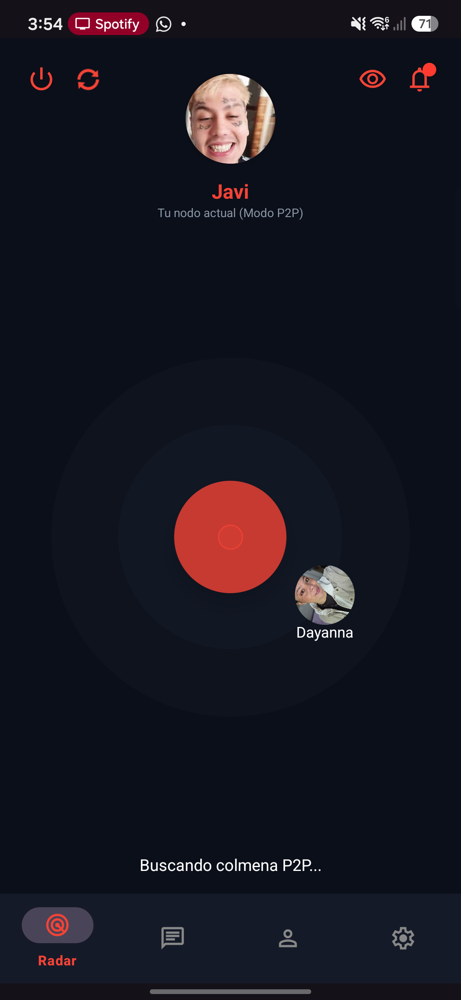
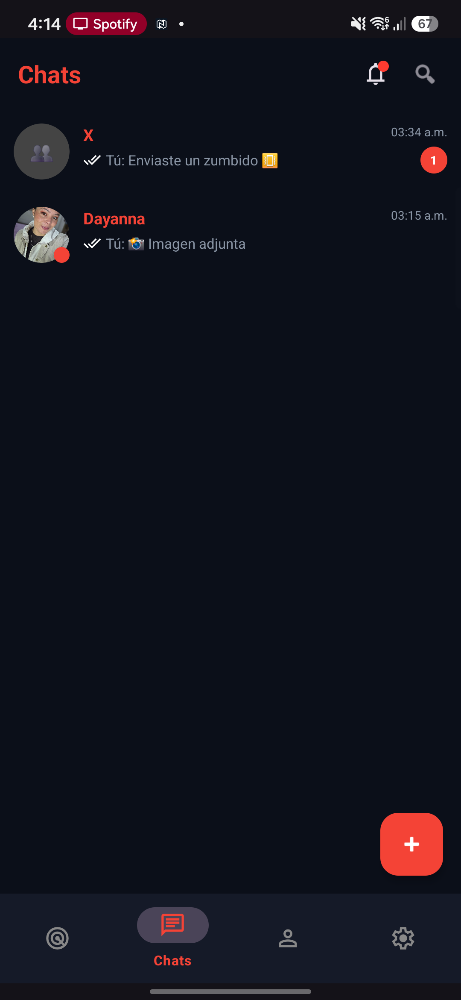
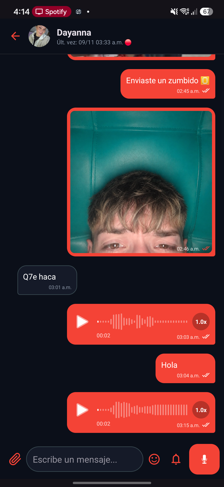
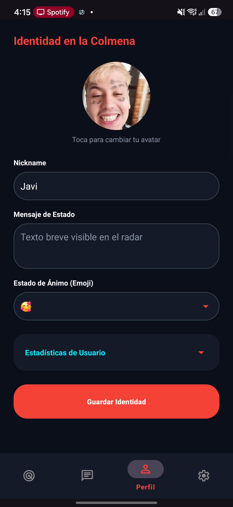
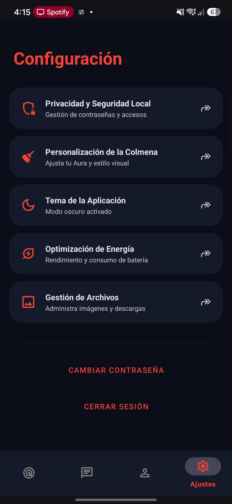

# NexuChat

dsNexuChat es una aplicación de mensajería instantánea P2P (Peer-to-Peer) descentralizada para Android que usa **Bluetooth / Google Nearby Connections** para establecer conexiones directas entre dispositivos cercanos y formar una red mesh. No requiere internet, Wi-Fi con router ni servidores centrales: cada teléfono es un nodo, y los mensajes pueden saltar de nodo en nodo (hasta 4 saltos) para llegar a destinos fuera de alcance directo.

**Autores:** David Santiago Rodríguez Barrero, Jeison Javier Cadena Celis, Nelson Javier Velásquez

---

## Tabla de contenido

- [Capturas de pantalla](#capturas-de-pantalla)
- [Funcionalidades](#funcionalidades)
- [Arquitectura y stack técnico](#arquitectura-y-stack-técnico)
- [Permisos que solicita la app](#permisos-que-solicita-la-app)
- [Cómo compilar y ejecutar](#cómo-compilar-y-ejecutar)
- [Cómo probar](#cómo-probar)
- [Limitaciones conocidas](#limitaciones-conocidas)
- [Documentación adicional](#documentación-adicional)

---

## Capturas de pantalla

> Capturadas en un dispositivo físico real (Samsung Galaxy A55, `SM-A556B`) corriendo la build actual.

| Radar P2P | Lista de chats |
|---|---|
|  |  |

| Conversación | Perfil |
|---|---|
|  |  |

| Ajustes |
|---|
|  |

---

## Funcionalidades

Estado real verificado en el código, no aspiracional. Basado en el catálogo completo de [`docs/funcionalidades.md`](docs/funcionalidades.md).

### Identidad y Perfil
| Funcionalidad | Estado |
|---|---|
| Creación de usuario local (nickname, sin servidor) | ✅ Implementado |
| Multicuenta en el mismo dispositivo | ✅ Implementado |
| Aura (color de nodo personalizable) | ✅ Implementado |
| Foto de perfil / avatar, sincronizado entre nodos conectados | ✅ Implementado |
| Habilidad/ocupación, bio, emoji de estado | ✅ Implementado |
| Login biométrico (huella/rostro) opcional | ✅ Implementado |

### Conectividad (Radar P2P)
| Funcionalidad | Estado |
|---|---|
| Escaneo y descubrimiento de nodos cercanos (radar animado) | ✅ Implementado |
| Conexión P2P con confirmación manual del receptor | ✅ Implementado |
| Enrutamiento mesh con reenvío entre nodos (TTL de 4 saltos) | ✅ Implementado |
| Modo Fantasma (dejar de emitir señal, solo escuchar) | ✅ Implementado |
| Reintento automático de mensajes pendientes al reconectar | ✅ Implementado |
| Servicio real en segundo plano (seguir recibiendo con la app minimizada) | ✅ Implementado — `ConnectionService` arranca su propio ciclo de advertising/discovery (`NexuMeshManager.iniciarModoWalkieTalkie`) y se reinicia solo si el sistema lo mata; `NexuApplication` lo arranca también al iniciar el proceso si ya hay una cuenta registrada |
| Notificación de proximidad ("Fulano entró en rango") | ✅ Implementado |

### Mensajería
| Funcionalidad | Estado |
|---|---|
| Chats 1 a 1 | ✅ Implementado |
| Chats grupales (crear, añadir/quitar miembros, avatar de grupo) | ✅ Implementado |
| Mensajes efímeros (autodestrucción por tiempo) y grupos efímeros | ✅ Implementado |
| Envío de imágenes, video, documentos y notas de voz | ✅ Implementado |
| Confirmaciones de entrega y lectura (check gris/azul) | ✅ Implementado |
| Historial persistente local (Room/SQLite) | ✅ Implementado |
| "Zumbido" (nudge) con vibración | ✅ Implementado |
| Reenvío de mensajes entre chats | ✅ Implementado |
| Bóveda multimedia por chat (fotos, videos, documentos, enlaces) | ✅ Implementado |
| Indicador de batería del emisor en cada mensaje | ✅ Implementado |
| Alertas de conexión/desconexión dentro del chat | ✅ Implementado |
| Cifrado de extremo a extremo real | ✅ Implementado — ver [Limitaciones conocidas](#limitaciones-conocidas) |

---

## Arquitectura y stack técnico

- **Lenguaje:** Kotlin, 100% nativo (sin frameworks multiplataforma).
- **Mínimo SDK:** Android 8.0 (API 26). `compileSdk`/`targetSdk`: 34.
- **Persistencia:** Room (SQLite) — dos entidades principales, `messages` y `groups`.
- **Red P2P:** [Google Nearby Connections](https://developers.google.com/nearby/connections/overview) (`com.google.android.gms:play-services-nearby`), estrategia `P2P_CLUSTER`.
- **Protocolo de aplicación:** mensajes de texto plano con cabeceras propias sobre los payloads de Nearby (`MESH|`, `GMESH|`, `SYS:GROUP_CREATE|`, `TXT:`, etc.) para enrutamiento, ACKs y comandos de grupo.
- **Reproducción multimedia:** AndroidX Media3/ExoPlayer para video.
- **Biometría:** AndroidX Biometric.
- **UI:** Vistas tradicionales (View Binding), sin Jetpack Compose.

### Estructura de paquetes (`app/src/main/java/com/offline/nexu/`)
```
data/           Entidades Room, DAO, Prefs (SharedPreferences)
data/network/   NexuMeshManager — envío/recepción de paquetes P2P, protocolo mesh
ui/home/        Radar (HomeActivity) y P2PManager — estado global de conexión
ui/chat/        Lista de chats, conversación, grupos, bóveda multimedia
ui/profile/     Perfil del usuario
ui/settings/    Ajustes, privacidad, personalización, tema
ui/login/       Registro/acceso local y multicuenta
notifications/  Receiver de notificaciones de conexión entrante
utils/          Utilidades (tema, generador de IDs de mensaje)
```

---

## Permisos que solicita la app

Cada permiso se pide en tiempo de ejecución justo antes de usarse (no todos al abrir la app):

| Permiso | Para qué | Cuándo se pide |
|---|---|---|
| `ACCESS_FINE_LOCATION` / `ACCESS_COARSE_LOCATION` | Requisito del sistema operativo para escanear Bluetooth/BLE | Al abrir la pantalla Radar |
| `BLUETOOTH_SCAN` / `BLUETOOTH_ADVERTISE` / `BLUETOOTH_CONNECT` (Android 12+) | Descubrir y conectar con nodos cercanos | Al abrir la pantalla Radar |
| `NEARBY_WIFI_DEVICES` (Android 13+) | Nearby Connections usa Wi-Fi Direct/Aware además de Bluetooth | Al abrir la pantalla Radar |
| `POST_NOTIFICATIONS` (Android 13+) | Mostrar notificaciones de mensajes, solicitudes de conexión, grupos | Al abrir la pantalla Radar |
| `CAMERA` | Tomar foto para enviar en el chat | Al tocar el botón de cámara en un chat |
| `RECORD_AUDIO` | Grabar notas de voz | Al mantener presionado el botón de enviar |
| `READ_MEDIA_IMAGES` / `READ_MEDIA_VIDEO` / `READ_EXTERNAL_STORAGE` (según versión) | Adjuntar imágenes/videos de la galería | Al abrir el selector de galería |
| `VIBRATE` | Vibración al recibir zumbidos/notificaciones | No requiere diálogo (normal) |
| `FOREGROUND_SERVICE` / `FOREGROUND_SERVICE_CONNECTED_DEVICE` | Mantener la conexión P2P activa en segundo plano | No requiere diálogo (normal) |

---

## Cómo compilar y ejecutar

Requisitos: Android Studio reciente, JDK 17+ (el proyecto usa el JBR incluido en Android Studio), SDK de Android con API 34 instalado.

```bash
git clone https://github.com/santiagokw11/Proyecto-NexuChat.git
cd Proyecto-NexuChat
./gradlew assembleDebug      # compila el APK de debug
./gradlew lintDebug          # análisis estático
./gradlew build              # build completo (igual al que corre en CI)
```

El APK queda en `app/build/outputs/apk/debug/app-debug.apk`. Para probar la conectividad P2P real se necesitan **dos dispositivos físicos** (el emulador no soporta Bluetooth/Nearby Connections).

---

## Cómo probar

La app incluye un **Modo de Pruebas (DEBUG)** que funciona con un solo dispositivo o en el emulador, sin necesitar un segundo nodo real:

1. En la pantalla **Radar**, toca **5 veces seguidas el centro del radar** (tu propio nodo).
2. Aparecerá **"🛠 MODO DEBUG"** y un nodo simulado **"Robot" 🤖**.
3. Toca a "Robot" para abrir un chat simulado y probar mensajes e historial.
4. Toca otra vez 5 veces el centro del radar para volver a **"🌐 MODO REAL"**.

Guía completa, incluyendo la prueba con dos dispositivos reales: [`docs/pruebas.md`](docs/pruebas.md).

---

## Limitaciones conocidas

- **Alcance del cifrado E2E.** El contenido de los mensajes (texto, comandos de sistema, encabezados de archivo) se cifra con AES-256-GCM usando una clave derivada por ECDH (curva P-256) entre el emisor y el destinatario real; un nodo que solo reenvía el paquete por la malla no puede leerlo, solo reenviarlo. La llave pública se intercambia automáticamente al conectar con un vecino directo, así que funciona de inmediato en el escenario probado (dos dispositivos en alcance). Si un mensaje se envía antes de completarse ese intercambio (poco probable, es casi instantáneo), viaja marcado explícitamente como no cifrado en vez de fallar. Los bytes crudos de imágenes/video/audio/documentos no se cifran a nivel de aplicación (viajan tal cual sobre el transporte ya cifrado de Nearby Connections). El interruptor "Cifrado de base de datos" en Ajustes → Privacidad es independiente de esto: solo exige biometría para abrir la app, no cifra el contenido de la base de datos en disco.
- **El alcance real depende del hardware y el entorno** (paredes, interferencia), normalmente 10-30 m en campo abierto.
- El servicio en segundo plano puede ser detenido por el sistema operativo si el usuario desliza la app fuera de "Recientes" en fabricantes con gestión agresiva de batería (p. ej. Samsung); `START_STICKY` y el arranque desde `NexuApplication` lo recuperan en la mayoría de los casos, pero no hay garantía absoluta de Android.

---

## Documentación adicional

- [Ideas iniciales y justificación del proyecto](docs/ideas.md)
- [Catálogo completo de funcionalidades y requerimientos técnicos](docs/funcionalidades.md)
- [Diseño de interfaz (mockups)](docs/ui.md)
- [Guía de pruebas (Modo DEBUG y dispositivos reales)](docs/pruebas.md)
